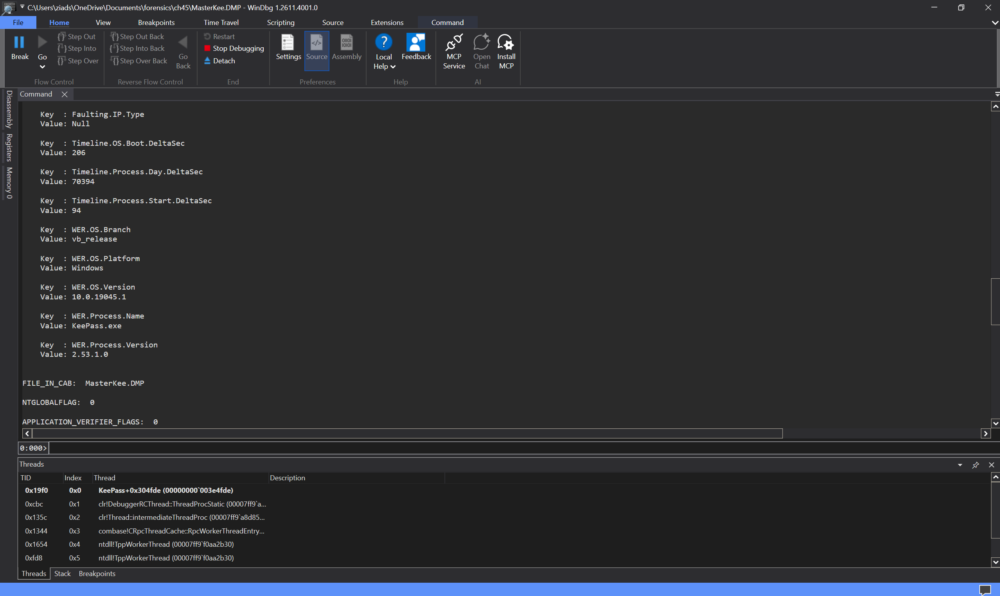
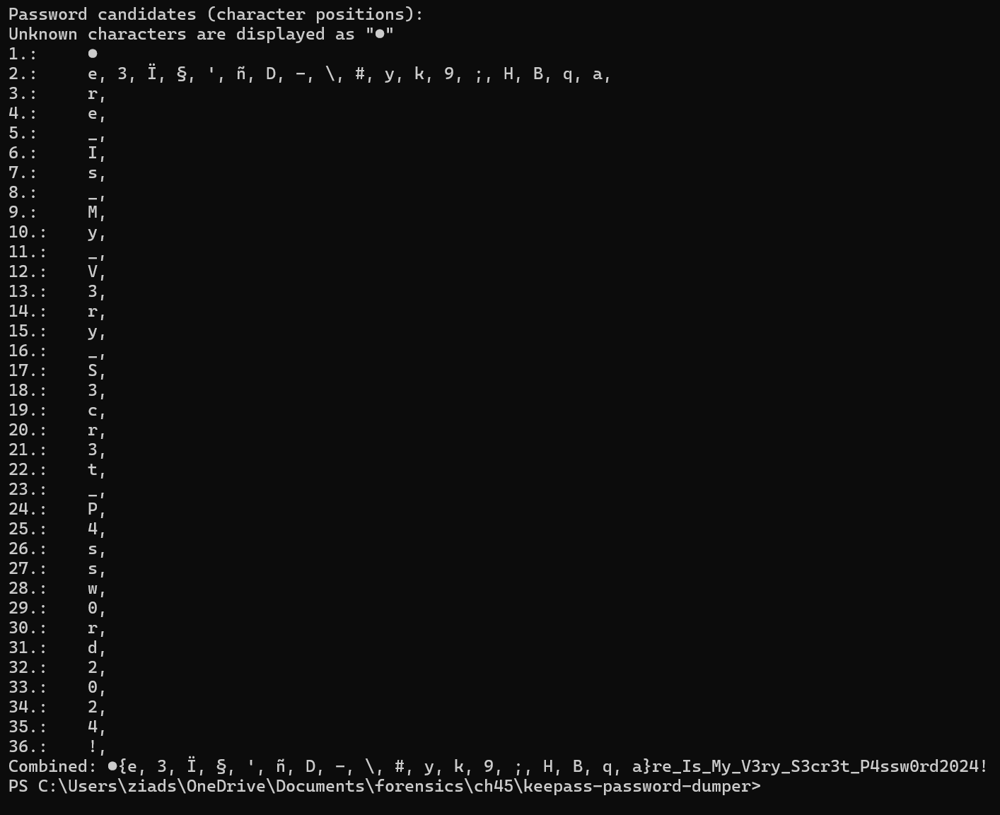
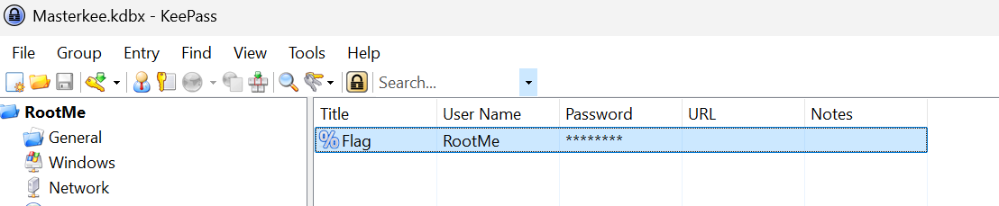

Challenge: [RootMe - MasterKee](https://www.root-me.org/fr/Challenges/Forensic/MasterKee)

## Definitions

**KeePass** is a password management application. It stores all credentials in a single encrypted database file (`.kdbx`), unlocked with one master password.

**CVE-2023-32784** is a critical sensitive-data-exposure vulnerability in KeePass 2.x (before 2.54). It affects how the master password edit box (`SecureTextBoxEx`) handles typed input in memory. Because `SecureTextBoxEx` is built on .NET, and .NET strings are immutable (a string object can never be edited in place), every keystroke forces the creation of a brand-new string object containing the full password typed so far — the previous object can't be edited, only replaced. The old object becomes garbage (unreferenced), and the garbage collector marks its memory as reusable — but "reusable" does not mean "wiped." The actual bytes stay intact until something else physically overwrites that memory region, which can take minutes, hours, or may never happen before the process exits. That is what makes the master password recoverable from a memory dump, even long after typing it, and even after KeePass has closed.

## Solution

After downloading the challenge folder, I listed the files and found a `.kdbx` database — meaning the flag is locked behind a master password — alongside a `.dmp` file (a memory dump, i.e. a raw snapshot of a process's RAM at the moment it was captured).

I opened the dump in WinDbg and ran `!analyze -v` (`-v` for verbose):



This confirmed the dump belongs to **KeePass.exe version 2.53.1.0**. That version number is the first real lead — before going further, I checked whether that specific version had any known CVEs.

It does: **CVE-2023-32784**, described above.

Searching for a public exploitation method led to a simple, ready-made PoC: [keepass-password-dumper](https://github.com/vdohney/keepass-password-dumper). Running it against the dump is a single command:

```
dotnet run MasterKee.DMP
```



The tool recovers every character except the first one or two, and instead lists the plausible candidates for that gap. Reading the recovered tail as a real phrase (`re_Is_My_V3ry_S3cr3t_P4ssw0rd2024!`) made the missing opening obvious: **"Here"**.

Master key: `Here_Is_My_V3ry_S3cr3t_P4ssw0rd2024!`

Unlocking the database with that key reveals the flag:



**Flag:** `RM{Upd4T3_KeEPas5_t0_2.54}`

## Takeaway

The flag itself says it: update KeePass to 2.54+. The fix replaces the leaky immutable-string handling with memory that gets explicitly scrubbed (zeroed) after use, instead of relying on the garbage collector's unpredictable timing to eventually overwrite it.
