Lab: [CyberDefenders - PsExec Hunt](https://cyberdefenders.org/blueteam-ctf-challenges/psexec-hunt/)

## Scenario

An IDS alert flagged suspicious lateral movement involving PsExec. As a SOC analyst, the task is to trace the attacker's activity through a provided PCAP: entry point, targeted machines, extent of the breach, and the tactics used.

## Definitions

**PsExec** is a legitimate Sysinternals remote-execution tool: it copies a small service binary (`PSEXESVC.exe`) onto a target over SMB, installs and starts it as a Windows service via the Service Control Manager, then uses that service to run commands remotely and relay their input/output back over the network. It's a standard sysadmin tool — and also one of the most common "living-off-the-land" tools attackers abuse for lateral movement, because its traffic can look like normal admin activity at a glance.

**IPC$** and **ADMIN$** are default hidden Windows administrative shares. `IPC$` (Inter-Process Communication) carries named pipes used for things like service control and authentication — it's not a filesystem share, there's nothing to "browse." `ADMIN$` maps directly to `C:\Windows` and is where PsExec drops its service binary.

**NTLMSSP** (NTLM Security Support Provider) is the authentication exchange visible in SMB2 traffic. Its `NTLM Server Challenge` message includes a `Target Name` field — the NetBIOS name of the machine being authenticated against — which is the easiest way to confirm *which* host is on the receiving end of a given session.

## Investigation

**1. Identifying the attacker's IP**

`Statistics → Endpoints → IPv4`, sorted by packet count, to find the busiest host — then confirming that volume is actually suspicious rather than just a chatty server, not assuming traffic volume alone proves anything:

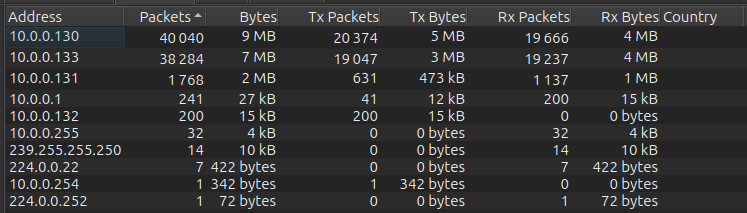

`10.0.0.130` stands out immediately. Filtering on it:

```
ip.addr==10.0.0.130
```

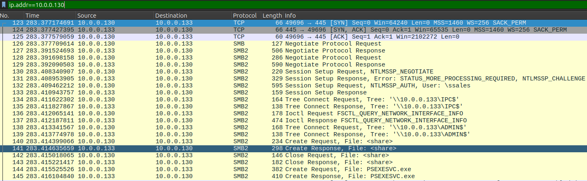

`PSEXESVC.exe` appears directly in the packet list against `10.0.0.133`, confirming `10.0.0.130` as the attacker's machine and `10.0.0.133` as its first target.

**2. Tracing the lateral movement**

Filtering on the SMB2 protocol and reading the NTLM challenge's `Target Name` field identifies the destination host by name without needing deep SMB2 protocol knowledge:

```
_ws.col.protocol == "SMB2"
```

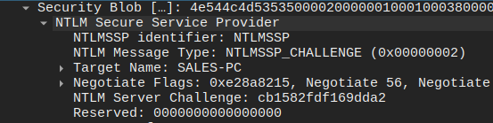

Target Name: `SALES-PC`. The session details confirm the attacker's own host:

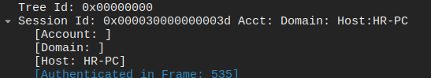

So the first hop is `HR-PC (10.0.0.130) → SALES-PC (10.0.0.133)`.

(A more protocol-specific route to the same answer: filter directly on `ntlmssp.challenge.target_name`.)

**3. Identifying the username used**

Staying on the SMB2 filter and reading the `Session Setup Request` / NTLMSSP_AUTH line directly:

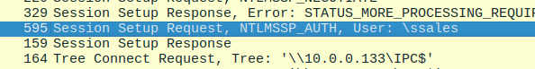

Username: `ssales`. So the first move is `HR-PC (10.0.0.130)` authenticating to `SALES-PC (10.0.0.133)` as `ssales`.

**4. What the attacker did on the compromised machine**

PsExec's standard workflow: authenticate, then push and start its service binary. The `Create Request/Response` packets for `PSEXESVC.exe` confirm exactly that:

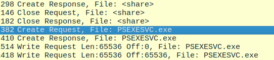

This isn't the attacker deploying a custom C2 (command-and-control) payload — PsExec's own service binary is doing the work. The "malicious" part is the *use* of a legitimate admin tool for unauthorized remote execution, not the binary itself.

**5. Which share was used to drop the file**

The `Tree Connect` packets show the session connecting to `IPC$` first (for authentication/service control), then `ADMIN$` — the share PsExec actually uses to write `PSEXESVC.exe`, since `ADMIN$` maps straight to `C:\Windows`:

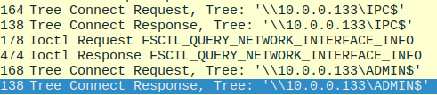

**6. Which channel PsExec uses to relay command I/O**

Once the service is running, PsExec doesn't talk over `ADMIN$` anymore — it communicates through named pipes carried over `IPC$`. The giveaway is the pipe naming convention, visible directly in the file field of the read/write packets: `PSEXESVC-HR-PC-7980-stdin` / `-stdout`:

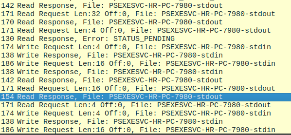

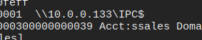

So: `stdin`/`stdout`/`stderr` are the three named pipes PsExec creates per session to relay a remote command's input and output — the transport underneath all three is the `IPC$` share.

**7. Finding the second pivot**

Rather than repeating the Target Name lookup challenge-by-challenge, filtering directly on authenticated usernames scales better when there are more than two hops:

```
ntlmssp.auth.username
```

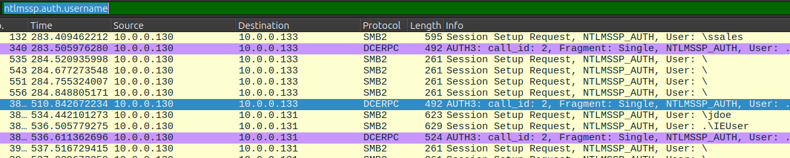

Second username: `jdoe`, originating from `10.0.0.131`. Using the same NTLM Target Name lookup as step 2 for that session:

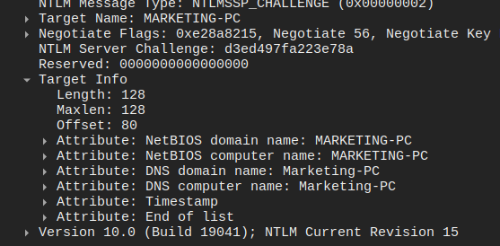

Target: `MARKETING-PC`.

## Kill chain summary

| Step | Host | IP | Action |
|---|---|---|---|
| 1 | HR-PC (attacker) | 10.0.0.130 | Initial foothold |
| 2 | SALES-PC | 10.0.0.133 | Authenticated as `ssales`, PsExec deployed via `ADMIN$`, commands relayed via named pipes over `IPC$` |
| 3 | MARKETING-PC | via 10.0.0.131 | Authenticated as `jdoe` — second pivot |

## Takeaway

PsExec abuse is detectable without any payload analysis at all — the pattern (`IPC$` auth → `ADMIN$` write of `PSEXESVC.exe` → named pipes matching `PSEXESVC-<hostname>-<pid>-std*`) is consistent and visible purely at the SMB2 protocol level. That consistency is exactly what makes it a strong, reliable detection signature for threat hunting: you don't need to know what the attacker ran, just that this specific service-install-and-pipe pattern happened on an account/host that shouldn't be doing remote admin work.
