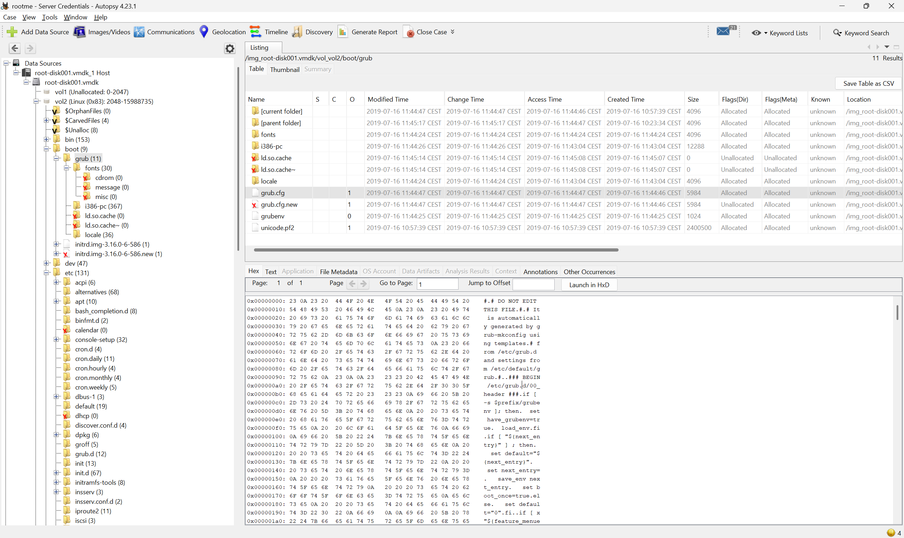
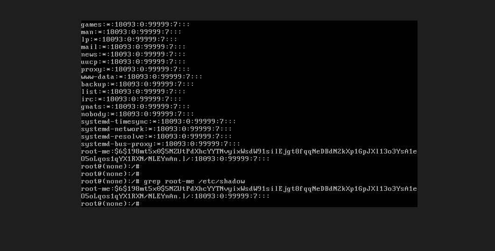
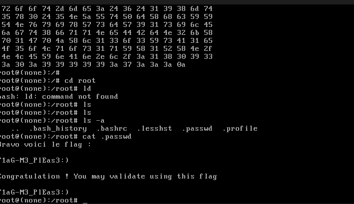

Challenge: [RootMe - Oh My Grub](https://www.root-me.org/fr/Challenges/Forensic/Oh-my-Grub)

## Definitions

In a normal Linux boot sequence: **BIOS/UEFI → Bootloader → Kernel → init/systemd → login**.

**GRUB** (GRand Unified Bootloader) is the bootloader step: it runs right after BIOS/UEFI hands off control, and its job is to load the kernel into memory and start it with a given set of parameters. It's the menu you see on a dual-boot machine letting you pick an OS. GRUB is standard on most Unix-based systems.

**.ova (Open Virtualization Archive)** is a tar archive bundling an `.ovf` file (an XML descriptor of the VM's hardware/config), a `.mf` manifest (checksums to verify the archive wasn't tampered with), and one or more `.vmdk` files — the actual virtual disk image(s).

## Solution

Listed the archive contents first:

```
tar -tvf root.ova
```

Inside was a `.vmdk` (virtual disk). Before booting it, I inspected it statically in **Autopsy** (a disk forensics tool for browsing a disk image's filesystem without running it) and found GRUB's own config wasn't password-protected:



This matters because GRUB runs *before* any OS-level login exists — a bootloader has no concept of "authenticated" yet. A password-less GRUB menu means anyone with console access can edit the boot parameters with zero credentials.

I booted the disk in VirtualBox and, at the GRUB menu, edited the `linux` boot line, appending:

```
init=/bin/bash
```

This replaces the normal init process (PID 1, the very first process Linux starts, which would otherwise kick off the whole login chain) with a plain bash shell — running as root. It's not bypassing a login prompt; it's skipping past the point where one would ever get created.

From that root shell I checked `/etc/shadow` to confirm the target account and its password hash:



I considered cracking the hash with hashcat, but running `ls -a` in `/root` first turned up a hidden `.passwd` file holding the plaintext credential directly — no cracking needed:



**Flag:** `F1aG-M3_PlEas3:)`

## Takeaway

An unprotected GRUB config turns physical/console access into instant root, independent of how strong the actual user passwords are. Locking it down means setting a GRUB superuser password (`grub-mkpasswd-pbkdf2` + `password_pbkdf2` in `grub.cfg`), which forces authentication before any boot parameter can be edited.
